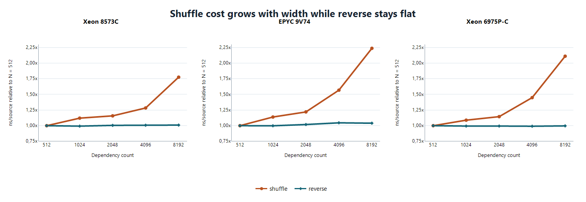

# Порядок зависимостей при локальных правках и глобальных перестановках

## 1. Current model

Исходная ревизия исследования — `0d37b93`. У узла девять полей. Ребро с восемью полями одновременно входит в список зависимостей потребителя и список подписчиков источника. Успешный `get` должен немедленно вернуть значение и установить наблюдение. Валидация computed идёт в порядке первых успешных чтений. Порядок чтения может определять, получит вызывающий код значение или исключение. [Контракт](../CONTRACT.md) · [ядро](../src/kernel.ts) · [представление графа](../src/graph.ts)

В стабильном проходе регистр курсора даёт следующее ребро. Немедленный повтор сохраняет первую версию. При промахе Quant использует точные свидетельства отсутствия со стороны источника, один шаг вперёд, два места с хвоста и ограниченные поиски с бюджетом восемь. Ребро, пропущенное дважды, переносится в конец. При первом неразрешённом промахе пара в голове списка подписчиков позволяет один раз пометить непрочитанный суффикс `UNREAD`. Более глубокая пара или исчерпанный бюджет приводят к заполнению слотов источников. Вложенный проход возвращает вытесненные слоты. Курсор и свидетельство владения слотом имеют время жизни исполнения. [LOG 28–29, 43, 47, 49–50](./LOG.md) · [модель и история](./REPORT.md) · [аудит границ доступа](./ACCESS-AUDIT.md)

Различие с исходной cost model видно уже без секундомера. Значения ниже — средние на проход при N = 4096, с дополнительным чтением сигнала `tick`.

| Текущий путь | Чтения | Cursor hits | Tail hits | Lookups | Размер пометки | Размер slot index | Вызовы `moveDep` |
| --- | ---: | ---: | ---: | ---: | ---: | ---: | ---: |
| Reverse | 4097 | 2 | 4094 | 0 | 0 | 0 | 4095 |
| Shuffle, первый подписчик | 4097 | 11 | 0 | 4086 | 4096 | 0 | 4086 |
| Shuffle, исследовательский `index-always` | 4097 | 11 | 0 | 4086 | 0 | 4097 | 4086 |

Для reverse число вызовов выведено из 4094 попаданий с хвоста и одного первого skip. Счётчик `stats.moves` увеличивает только `take`, поэтому на этом reverse он равен нулю. На всех трёх путях `links = unlinks = 0`. `indexed` включает также помеченные рёбра. Значение `stackHighWater = 256` здесь показывает начальную ёмкость массива. [Структурный worker](../bench/cost/structure-worker.mjs) · [горячие пути](../src/kernel.ts)

## 2. Observed anomaly

Положительный остаток **14,48 нс/источник** относится к slot-ревизии `816acde` на EPYC 7763. При N = 1024 он составлял −0,10. Позднее переход на поиск через подписчиков уже уменьшил стоимость полного shuffle. Историческая декомпозиция вычитает измерения отдельных программ. В `index` граф застывает после первого построения, `clearIndex` дополнительно восстанавливает версии, `move` получает заранее известные рёбра, а `full` читает приложение и перестраивает граф. Остаток сам по себе не измеряет число cache misses или длительность конкретного stall. [Исходные числа и исправления](./COST-MODEL.md) · [исторический CI](https://github.com/volynetstyle/reflex-quant/actions/runs/42252842592)

Текущая версия сохраняет расхождение по ширине. На Xeon 8573C один и тот же runner измерил 22,54 → 24,95 → 25,77 → 28,68 → 40,29 нс/источник для shuffle при N = 512, 1024, 2048, 4096, 8192. Для reverse весь диапазон составил 14,84–15,04. При N = 4096 принудительные slots стоили 34,87, Reflex — 23,52, Quant с пометкой — 28,68 нс/источник. [Данные одного runtime-job](https://github.com/volynetstyle/reflex-quant/actions/runs/44304013295/job/134800746629)



Каждая точка — медиана парных отношений нс/источник к своему сценарию при N = 512 на том же runner. [Построение графика](./reorder-figure.ps1)

## 3. Competing hypotheses

Пороги зарегистрированы до первого измерения. Для H1–H4 равенство с контролем в пределах разброса A/A либо эффект противоположного знака ослабляет предложенный механизм. Размеры ограничены пятью точками от 512 до 8192. [Исходный протокол](https://github.com/volynetstyle/reflex-quant/blob/e33844e8dab3ebeff8a3bd727fdb9add06b713f5/research/REORDER-LOCALITY.md)

| Гипотеза | Что она объясняет и что остаётся вне неё | Фальсифицирующий опыт и структурная сигнатура | Предсказание при 4096 |
| --- | --- | --- | --- |
| H1. Каждый адрес следующего ребра зависит от предыдущей загрузки | Замедление пометки и индекса. Стоимость одиночного lookup остаётся отдельным вопросом. | Та же запись версии в те же N рёбер в том же порядке, адрес из `nextDep` или из вектора. | Случайная цепочка минимум на 20% дороже вектора. |
| H2. Разброс адресов назначения удорожает slot-записи | Дополнительная стоимость index/clear. Пометка касается только рёбер. | Независимо переставить ранги рождения источников и рёбер. Ровно 2N slot-записей и 2N переходов по рёбрам. | Источники в случайном порядке даже при последовательных рёбрах дают ≥10%. |
| H3. Адрес для переноса поздно появляется из `source.slot` | Дорогая комбинация lookup + move. До первого переноса действует H1/H2. | Сравнить готовое ребро с полученным из источника. Отдельно изменить размер блока выдачи адресов с 1 до 32 с теми же lookup, переносами и записями. | Каждый из двух вариантов уменьшает свою контрольную стоимость ≥10%. |
| H4. Большой охват страниц достаточен для перегиба | Даёт замедление даже при одинаковом числе полезных линий. Соответствие страницам реального JS-графа нужно проверять отдельно. | Одна случайная загрузка на 64-байтную линию. Разместить линии плотно или по одной на 4 КиБ, сбалансировать смещения внутри страницы. | Отношение разреженного к плотному >1,20. |
| H5. Достаточно GC, расположения кода или изменившихся ветвлений | Объясняет ложные выигрыши на разных сборках. Предсказывает слабый эффект при фиксированной программе и числе операций. | Одинаковые байты A/A, GCProfiler в фазе sampling, проверка количества ветвей переноса, независимые размещения. | Воспроизводимое расхождение сверх A/A при нуле сборок исключает объяснение исключительно GC и байтами сборки. Измерение промахов предсказателя требует PMU. |

## 4. Experiments and falsification results

**Семантика.** Перед таймингом сверяются 64 шага. У shuffle сумма инвариантна к порядку, поэтому дополнительно сверялись все ссылки, порядок, идентичность рёбер и граничные указатели на четырёх переходах. 312 наблюдаемых исходов проверяют D1, в том числе после фактической широкой перестановки. Проверены частичные проходы с двумя ошибками, исчезновение прежней tentative-связи, вложенный поиск, P5 и disposal с исключением. При принудительных GC слабая ссылка на прежнее ребро очищается при удержанном disposed consumer. [Исполняемые свидетели](./reorder-witness.mjs)

**Структура.** За четыре прохода при 4096 оба варианта splice выполнили 16 344 переноса, из них 28 с хвоста. Произошло 98 064 записи указателей и 16 384 записи версий. Выбор ребра через slot добавил 16 384 чтения поля источника. У tile1 и tile32 совпали все учтённые чтения и записи полей графа. Ранги рождения объектов задают порядок создания. Фактические адреса после перемещения GC недоступны. [Независимый счётчик JS-полей](./reorder-streams.mjs) · [фикстуры](../bench/cost/locality.mjs)

**Физическое время.** Ниже показаны парные медианы отношений на N = 4096. Каждая колонка содержит результат своего эксперимента. Значения разных машин в наносекундах не объединялись.

| Интервенция | Серия 1 | Серия 2 | Серия 3 | Вывод |
| --- | ---: | ---: | ---: | --- |
| H1, chain / vector на случайных рёбрах | 3,31 | 4,81 | 4,84 | Зависимая адресация сильно влияет даже при одинаковом порядке целевых записей. |
| H2, случайные / последовательные источники при последовательных рёбрах | 1,27 | 1,14 | 1,68 | Направление воспроизводится. В первых двух сериях при 1024 оценки близки к единице. |
| H2, случайные / последовательные рёбра при последовательных источниках | 1,72 | 1,72 | 2,42 | Две оси дают независимо наблюдаемые эффекты. |
| H3, готовое ребро / slot перед переносом | 0,768 | 0,707 | 0,816 | Штраф за получение адреса через источник воспроизводится. |
| H3, блок 32 / блок 1 | 0,716 | 0,614 | 0,706 | Расписание меняет стоимость при тех же операциях с графом. Блок меняет также накладные расходы циклов. |
| H4, одна линия на страницу / плотные линии | 2,32 | 2,77 | 2,14 | Разреженность значима в контроле. TLB-доля в V8 остаётся неизвестной. |

Предоставление адресов в этих probes — экспериментальный контроль со знанием будущего расписания. Приложение в общем случае может выбирать следующий источник по только что прочитанному значению. [Серия 1](https://github.com/volynetstyle/reflex-quant/actions/runs/44304013295) · [серия 2](https://github.com/volynetstyle/reflex-quant/actions/runs/44306105316) · [серия 3](https://github.com/volynetstyle/reflex-quant/actions/runs/44308110360)

## 5. Physical explanation

У полного прохода есть три разных порядка. Список потребителя задаёт адреса рёбер для mark/index. Источник задаёт адрес назначения slot-записи и адрес найденной связи. Пользовательский callback задаёт порядок загрузки значений и переноса рёбер. На reverse эти потоки пространственно упорядочены. На shuffle предыдущая и следующая перестановки различаются, поэтому близость по одному порядку мало говорит о близости по другому.

- **Обход потребителя.** Следующий адрес в списке становится известен после загрузки предыдущего `nextDep`. Вектор позволяет выдать несколько независимых адресов тем же рёбрам. Сравнение H1 удерживает постоянными целевые линии и порядок записей. При scatter ограничение одной лишь пространственной близостью получателей неполно.
- **Источник и subscriber list.** В одночитательском shuffle достаточно загрузить голову `firstSub` и проверить `to`. Глубокого прохода по подписчикам нет. В `shared-chaotic.64x32` один читатель в типичном шаге помечает, ещё 31 индексирует. При slot-поиске прочитанный узел ведёт к отдельному объекту ребра. Самостоятельный lookup имеет достаточно независимых итераций и не содержит последующих изменений соседей.
- **Перенос.** Для `moveDep` нужны старые соседи найденного ребра, затем шесть записей указателей. Следующий `last.nextDep` логически читает поле только что принятого ребра. При случайном порядке адрес старого соседа зависит от загрузки самого ребра. H3 устанавливает цену этой схемы адресации и расписания. Процессор может пересылать значение из store buffer, оптимизатор может устранить загрузку. Количество аппаратных stalls этими опытами не измерено.
- **Ёмкость, повторное использование линий, страницы.** Оценка живой кучи shuffle — около 0,29, 1,09 и 2,14 МБ при 1k, 4k и 8k. На 8573C `lscpu` показывает L2 в 2 МиБ на экземпляр, и наиболее крутой из измеренных переходов приходится на 4k→8k. Исторический 7763 с 512 КиБ показал более ранний подъём. Итоговая куча включает handles и расписания, занятая куча отличается от множества горячих линий. H4 варьирует также возможность prefetch и размещение физических страниц.
- **Код, ветви и GC.** У A/A одинаковый bundle. У сплайсов совпали последовательность целей и число tail-ветвей. Тот же код с разными данными сохраняет значительное различие. В историческом повторе все фазы дали ноль сборок при sampling. Прежние сборки уже показывали разницу режимов 10–17% при изменении байтов кода на большом N. Состояние JIT, предсказателя, аппаратный параллелизм запросов и NUMA по данному контролю отдельно не восстанавливаются. `perf stat` на исследованных CI-хостах получил отказ в доступе к аппаратным счётчикам. [Исторический контроль компоновки](./COST-MODEL.md)

Повтор старого ядра на EPYC 9V74 дал при 4096 остаток 6,67 нс/источник, из которого разность `T(lookup+move) − T(lookup) − T(move)` составляла 2,82. При 1024 соответствующие числа — 2,64 и −0,13. Если из полного времени вычесть чтения, **совместный** splice и среднюю стоимость индекса при четырёх законных старых порядках, при 4096 остаются 3,30 нс/источник. Это медианы парных разностей. Изменение порядка в изолированном index само по себе остаток не объяснило. [Реплика исторического эксперимента](https://github.com/volynetstyle/reflex-quant/actions/runs/44306105316/job/134807973231) · [воспроизводимая сборка](./reorder-vintage.mjs)

В заключительном опыте на Xeon 6975P-C прежний **полный** runtime исполнял тот же callback и все прежние операции. Варианты отличались способом получить адрес следующего ребра при заполнении и очистке слотов. Для четырёх фиксированных перестановок до измерения подготовлены векторы адресов. Проверка на входе в каждый выбранный обход подтвердила совпадение каждого элемента с действительной цепочкой, а на выходе — порядок списка и пустые слоты. На N = 4096 подача адресов только при заполнении дала **0,917** времени парного контроля, только при очистке — **0,828**, на обоих обходах — **0,769**. A/A дал 0,967. На N = 256 совместный результат составил 0,957, при 1024 — 0,810. При 4096 медиана парной экономии полного прохода — **6,18 нс/источник**. У исходного исторического bundle на этой job медиана составила 24,45 нс/источник, у нового контрольного кода с теми же вспомогательными массивами — 26,90. Все отношения рассчитаны относительно второго контроля. [Полный факторный опыт](https://github.com/volynetstyle/reflex-quant/actions/runs/44308110360/job/134814860639)

Это причинный результат на уровне алгоритма. Одинаковые цели slot-записей допускают существенно разное время полного прохода при изменении источника адресов. В этой же job остаток исходной декомпозиции при 4096 составил 6,06 нс/источник, lookup/move-взаимодействие — 0,57, после поправки на четыре размещения и совместную фазу осталось 1,29. Близость 6,18 и 6,06 не устанавливает тождество причин. Первое число относится к интервенции в инструментированный runtime, второе — к сумме разных программ исходной сборки. [Данные всех ячеек](./REORDER-RESULTS.json)

## 6. Representation alternatives

| Представление | Свидетельство, которое использует | Цена и область применимости |
| --- | --- | --- |
| Два конца, несколько локальных курсоров | Смежность с последним чтением или концом | Полный reverse уже выигрывает от хвоста. При произвольной перестановке противник может каждый раз выбирать вне фиксированного числа окон. |
| Чанки, сегменты, отложенный разворот блока | Длинная общая полоса в прямом или обратном порядке | У разворота компактное описание. Перестановка с Θ(d) одиночными полосами требует Θ(d) описаний, а D1 требует уметь воспроизвести их порядок. |
| Метки поколения или ранги чтения | Принадлежность проходу и позиция | Ранг помогает восстановить порядок после прохода. Поиск точной пары и сохранение первой версии при повторах остаются отдельными задачами. `gen` уже различает committed и tentative при отказе. |
| Частичный индекс и source-side hints | Точное попадание или исчерпание ограниченного бюджета | На первом подписчике адрес уже есть. Промах подсказки на источнике с большим fan-out не доказывает отсутствие пары. Существующие слоты дают линейную верхнюю границу. |
| Отдельное представление принятого порядка | Старое ребро продолжает подписывать потребителя, пока строится новый порядок | Два исполняемых кандидата ниже различаются способом сохранить непрочитанные связи. Постоянного индекса у них нет. |

## 7. Best candidate

Общий механизм отделяет поиск пары от перестройки порядка. При том же событии, которое сейчас включает пометку суффикса, он отсоединяет суффикс от принятого префикса. Первое чтение найденного ребра дописывает его в новый порядок. Повтор возвращает значение с сохранением версии первого наблюдения. Новая связь немедленно подписывается на источник.

**Вектор** сохраняет ссылки старого суффикса по порядку. Когда прочитаны все старые рёбра, их счётчик достигает нуля и выход пропускает восстановление. При частичном проходе вектор восстанавливает только непрочитанные связи в исходном порядке. **Обратные ссылки** используют уже имеющийся `prevDep` как старый порядок, а `nextDep` — как строящийся. Граница доступна через `oldHead.prevDep`. Три регистра исполнения хранят голову, хвост и число непрочитанных. После полной перестановки один проход по новому порядку чинит обратные ссылки. При неполном чтении старый порядок сначала перечисляется с хвоста. Оба кандидата возвращают обычный список перед переходом к глубокому slot index. [Сборка исследовательских копий](./reorder-build.mjs) · [вектор](./reorder-suffix.ts) · [обратные ссылки](./reorder-thread.ts)

**Наиболее перспективная из проверенных реализаций — обратные ссылки.** При shuffle@256 они сократили время на 13,4–14,3% в двух повторах и сохранили ноль сборок мусора в замерах чистых перестановок. При shuffle@4096 выигрыш составил лишь 3,7–5,6%, а для короткого стабильного вычисления оба раза возникла регрессия около 10%. По зарегистрированным порогам для production лучшим выбором остаётся текущий Quant. Оба прототипа доступны как исследовательские контрпримеры необходимости немедленно удалять ребро из его старого места. [A/B и семантические проверки](https://github.com/volynetstyle/reflex-quant/actions/runs/44308110465)

## 8. Semantic proof obligations

| Обязательство | Инвариант при перестройке и наблюдаемая проверка |
| --- | --- |
| T1/T2, D1, P5 | Префикс содержит ровно первые успешные чтения и по одному ребру на пару. `UNREAD` отличает старое непрочитанное ребро. Принятие записывает текущую версию один раз. Два порядка с инвертированной парой дают разные результаты в свидетеле из §13. |
| P2–P4, F2 | `peek/pull` завершаются до tracking, поэтому бросившее чтение не попадает в префикс. Старые исходящие подписки живы в ходе исполнения. `write` доходит до BUSY-потребителя через источник. Перед валидацией граф снова двусвязный. C1 определяет границу допустимого повторного входа. |
| F1, F3–F5, W1/W2/W5 | Перед существующими обработчиками успеха и ошибки восстанавливается принятый префикс, за ним непрочитанный остаток в прежнем порядке. Успех отрезает остаток. Отказ сохраняет committed и только tentative последней попытки. Обход не вызывает пользовательский код. Старое значение, обязанность повторить и порядок ошибок обрабатывает прежний протокол. |
| T3, вложенный индекс | Вход в `exec` сохраняет регистры родителя, оба выхода их возвращают. При исчерпании поиска текущая машина сначала материализует полный список и затем индексирует. Сохранённые слоты вложенных исполнений имеют исходный порядок LIFO. |
| W3, S4/S5, wrap | Самоудаление ставит терминальную отметку, восстановление выполняется до `detach`. Освобождение подписок и очистка указателей идут прежним путём. Ни одна схема не использует `gen` как временный тег. `SETTLE` видит полный список. Свидетель со слабой ссылкой покрывает удержание после ошибки и самоудаления. |

Это локальный инвариант реконструкции плюс исполняемые проверки. Общего доказательства уточнения всего JS-ядра здесь нет. Статические тесты transition ledger читают исходный production-файл. Прямые свидетели запускаются именно против собранных исследовательских копий. [Контракт](../CONTRACT.md) · [границы доказательств ablation](./WITNESS-AUDIT.md)

## 9. Structural cost model

Пусть R — число успешных чтений, d — старый размер фронтира, u — размер непрочитанного суффикса при переключении, a — число добавленных отношений. Стабильный проход стоит Θ(R) со стороны приложения, без поиска и создания отношений. На прямом ограниченном свидетельстве накладная работа привязана к промахам. Даже одно далёкое перемещение может впервые исчерпать бюджет и вызвать O(u) работы.

| После переключения | Вектор | Обратные ссылки |
| --- | --- | --- |
| Подготовка | u пометок и u ссылок в растущем массиве | u пометок и подсчёт |
| Полное чтение u рёбер | u дописываний, 0 обходов остатка | u дописываний, u починок `prevDep` |
| Частичный проход или отказ | до u просмотров сохранённых ссылок, затем прежний cut/fail | до u просмотров старой цепочки и один проход по восстанавливаемому суффиксу, затем cut/fail |
| Рабочая память | O(u) временных ссылок на переключившийся активный уровень | O(1) новых регистров на активный уровень |
| Постоянная память графа | прежние узлы и рёбра | прежние узлы и рёбра |

Исчерпание бюджета после переключения добавляет не более одного восстановления и одного индекса O(d+a). Общая верхняя граница tracking на проход — O(R+d+a), включая амортизированный рост массива у первого варианта. Разные уровни вложения владеют своим состоянием. При N = 4096 оба варианта выполняют 4096 дописываний при нуле online-splice, новых и удалённых рёбер. Первый сохраняет 4096 ссылок, второй на выходе исправляет 4096 обратных указателей. `stats.links` учитывает только рёбра. Временный вектор аллоцируется и при нуле `links`. [Структурные результаты](./REORDER-RESULTS.json)

## 10. CI performance evidence

Каждая ячейка каждого из семи раундов запускается в свежем процессе. Порядок псевдослучаен. Прогрев занимает минимум 300 мс и 2000 шагов, затем следуют калибровка, полная GC и 21 измерительный пакет. Первые 64 шага сверяются отдельно и внутри каждого timing worker. В одной job сравниваются production-сборки на Node 22.23.4. В таблицах кандидатов отношение — медиана семи **парных** отношений внутри конкретного runner. Все раунды, все контрольные нагрузки, хеши сборок, процессоры, структурные счётчики и данные о сборках мусора сохранены. [Worker](../bench/worker.mjs) · [runner](../bench/cost/locality-run.mjs) · [данные](./REORDER-RESULTS.json)

**Вектор.** Предсказание до реализации — shuffle@4096 ≤0,85, reverse@4096 и локальные нагрузки ≤1,05. Критерий выигрыша для обоих глобальных семейств дополнительно требует reverse ≤0,85. [Фиксация прогноза](https://github.com/volynetstyle/reflex-quant/commit/5a96d07) · [два повтора CI](https://github.com/volynetstyle/reflex-quant/actions/runs/44306105274)

| Вектор / Quant | Повтор 1 | A/A | Повтор 2 | A/A |
| --- | ---: | ---: | ---: | ---: |
| shuffle@1024 | 0,961 | 1,007 | 1,018 | 0,986 |
| shuffle@4096 | 1,011 | 1,007 | 0,964 | 0,973 |
| reverse@4096 | 0,989 | 0,999 | 0,952 | 0,957 |
| shuffle@8192 | 1,207 | 1,000 | 1,090 | 1,034 |
| insert-one@1024 | 1,029 | 1,026 | 0,996 | 0,995 |
| rotate-256 | 1,008 | 1,001 | 1,004 | 0,997 |
| branch-switch | 0,968 | 1,008 | 1,008 | 0,984 |
| replace-half | 1,022 | 1,042 | 0,997 | 1,007 |
| stable.wide-256 | 0,963 | 1,001 | 1,080 | 1,010 |
| swaps-nested@8 | 1,344 | 1,032 | 1,404 | 0,983 |

На shuffle@4096 вектор вызвал медианно 26,8 сборки на 1000 проходов в обоих повторах. Quant дал ноль. Измеренное время самих GC — около 1–2% выборки. Сюда не входит вся стоимость роста, заполнения и барьеров массива. На swaps-nested@8 переключение происходит в среднем раз в два прохода и затрагивает в среднем 380 рёбер на проход. Поэтому эта нагрузка отделяет стоимость позднего переключения от цены стабильного пути.

**Обратные ссылки.** До реализации зафиксированы ноль рабочих объектов на переключение, отсутствие sampling GC на чистой перестановке, shuffle@4096 ≤0,85, shuffle@8192 ≤0,95, reverse@4096 и все локальные контроли ≤1,05. Глобальные job независимо попали на EPYC 7763. Каждый столбец остаётся отношением к своей базе. [Фиксация прогноза](https://github.com/volynetstyle/reflex-quant/commit/2c27216) · [задания и артефакты](https://github.com/volynetstyle/reflex-quant/actions/runs/44308110465)

| Обратные ссылки / Quant | Повтор 1 | A/A | Повтор 2 | A/A |
| --- | ---: | ---: | ---: | ---: |
| shuffle@256 | 0,857 | 0,988 | 0,866 | 0,999 |
| shuffle@1024 | 0,916 | 1,036 | 0,911 | 0,978 |
| shuffle@4096 | 0,944 | 1,004 | 0,963 | 1,003 |
| reverse@4096 | 1,023 | 1,005 | 0,988 | 0,981 |
| shuffle@8192 | 0,901 | 0,941 | 0,917 | 0,909 |
| insert-one@1024 | 1,009 | 0,985 | 0,992 | 0,991 |
| rotate-256 | 0,987 | 0,993 | 1,006 | 1,003 |
| branch-switch | 1,049 | 0,994 | 1,036 | 1,010 |
| replace-half | 0,992 | 0,978 | 1,007 | 1,009 |
| track.stable-1 | 1,118 | 1,001 | 1,096 | 1,000 |
| long-reorder.256 | 0,914 | 1,002 | 0,852 | 0,992 |
| shared-chaotic.64x32 | 1,023 | 1,012 | 0,990 | 0,992 |
| swaps-nested@8 | 1,414 | 1,000 | 1,439 | 1,005 |

Предсказания по временной памяти и отсутствию коллекций на чистых перестановках подтвердились. На shuffle@4096 целевые 15% не достигнуты. У shuffle@8192 оба численных отношения ниже 0,95, но A/A тоже сместился до 0,941 и 0,909. Вторая оценка неотличима от такого сдвига. Reverse использует прежний хвостовой путь. В тех же двух глобальных job Reflex/Quant на shuffle@4096 составил 0,786 и 0,794. Вариант с обратными ссылками всё ещё медленнее Reflex в этой ячейке.

На `track.stable-1` счётчик переключений равен нулю. Изменились сохранение и восстановление регистров в `exec` и компоновка горячего кода. Их отдельные доли не измерены. На `swaps-nested@8` повторная регрессия 41–44% сохранилась при нуле GC. Идентичность множеств и отсутствие аллокаций сами по себе не окупают широкий проход ради нескольких переставленных рёбер. Обе исследовательские копии прошли 451 DEV-тест и 444 PROD-теста с семью DEV-only пропусками, а также отдельные наблюдаемые свидетели. Тайминги в отчёте происходят из 26 измерительных CI-job, в которых суммарно запущено 6062 свежих измерительных процесса. [CI вектора](https://github.com/volynetstyle/reflex-quant/actions/runs/44306105274) · [CI обратных ссылок](https://github.com/volynetstyle/reflex-quant/actions/runs/44308110465) · [сводка по раундам](./REORDER-RESULTS.json)

Для воспроизведения в рабочей копии после `npm ci`:

```sh
node bench/build.mjs
node bench/cost/build.mjs
node research/reorder-build.mjs
node research/reorder-build.mjs thread
node research/reorder-vintage.mjs
node --expose-gc research/reorder-witness.mjs .cache/reorder-thread/raw/index.mjs
node research/reorder-streams.mjs
node bench/cost/locality-run.mjs walk 0
```

Ноль раундов выполняет проверку без тайминга. В workflow указаны обе компоновки, переменная `SUFFIX_CANDIDATE`, повторения и команды измерений. После скачивания артефактов в каталоги по ID запусков `node research/reorder-results.mjs <каталог> <файл.json>` восстанавливает сводные данные. Историческая сборка требует git-объект `816acde`. [Физические probes в CI](../.github/workflows/reorder-locality.yml) · [кандидаты в CI](../.github/workflows/reorder-suffix.yml)

## 11. Rejected alternatives and why

- Индексировать после первого промаха уже пробовали. На insert-one в прежней серии это стоило 1,65–1,79 от Quant. Постоянный Map для каждой пары добавляет O(E) хранения к графу. У большинства исследованных локальных изменений уже есть ограниченное точное свидетельство. [Cost model](./COST-MODEL.md)
- Увеличение TAIL до восьми помогало некоторым вложенным пропускам и ухудшало replace-all-k3 и swaps. Поиск среди произвольных первых подписчиков давал регрессию на разделяемых источниках. Поворот и reverse уже используют хвост. [Trade-offs](./TRADEOFFS.md) · [LOG 28–29, 47–50](./LOG.md)
- Сокращение функции `miss`, сокращение числа исходных загрузок и изменения inlining давали нереплицируемые результаты на соседних нагрузках. В этих экспериментах критерием был полный проход и парные контроли. [Access audit](./ACCESS-AUDIT.md) · [Engine feedback](./ENGINE-FEEDBACK.md) · [раннее исследование форм кода](https://github.com/volynetstyle/reflex-quant/blob/b119660967a9ed8f3c40f3f1b12b918143f685a6/research/REPRESENTATION.md)
- Отложить все подписки до конца callback нарушает P5/W2 при записи в уже прочитанный источник. Отбросить порядок затрагивает D1. Зафиксировать расписание следующих четырёх перестановок допустимо для физического контроля и требует знания будущих чтений в произвольном приложении.

## 12. Remaining unexplained observations

1. Кривая согласуется с ёмкостью рабочего множества. Точная граница L2, доли DTLB, prefetch, store forwarding, branch misses и запросов памяти в полёте по этим данным не идентифицируются. Для отдельных линий физические адреса и реальные счётчики недоступны.
2. Вычитание примитивов оставляет вклад диспетчеризации, проверок, положения графа и различной истории прогрева. Точное разложение всех исторических 14,48 нс на аппаратные события остаётся открытым.
3. Четыре фиксированные перестановки, однородные сигналы, широкий shared-контроль и смесь локальных правок покрывают конкретные семейства. Распределение произвольных приложений, ошибки на каждом возможном шаге и все реализации JavaScript из них не следуют.
4. Вектор на shuffle@8192 оказался медленнее Quant в первых двух runner и быстрее в двух поздних совместных сравнениях на 7763. Для этого размера видны крупные сдвиги A/A. Данных недостаточно для переносимого коэффициента. Остаётся открытой возможность дешёвой классификации плотной перестановки до переключения, которая пропускает вложенные локальные обмены и не удорожает стабильный `exec`.

## 13. Theorem — сколько информации о порядке сохраняет D1

Зафиксируем d различимых computed-источников с одинаковыми начальными значениями, идентичностями и версиями. Потребитель успешно читает все d по одному разу. Допустим любой из d! порядков. После прохода приложение стирает описание порядка и на следующем исполнении возвращает константу. Для любых двух перестановок найдётся пара A, B в противоположном относительном порядке.

Сделаем так, чтобы при следующей валидации A изменил значение, B выбросил исключение, все остальные оставались прежними. Корень получает STALE через нижележащие сигналы. При A раньше B контракт D1 предписывает исполнение корня при первом изменении, и вызывающий получает константу. При B раньше A он получает исключение. Продолжение для этих двух историй одинаково. Следовательно, для выбранного класса программ доступное валидатору состояние вместе с достижимыми из него данными различает не менее d! состояний, то есть несёт не менее log₂(d!) бит информации о порядке при фиксированных именах источников. Для семейства из K попарно различимых порядков тот же аргумент даёт log₂(K) бит. Стабильный порядок и его разворот имеют всего две альтернативы, если исходный порядок уже сохранён. [Исполняемый различитель](./reorder-witness.mjs) · [D1 в контракте](../CONTRACT.md)

Граница относится к представленной информации. Её могут нести сами ссылки, последовательность идентичностей или журнал. Она не даёт нижней границы в log₂(d!) **операций**, дополнительных бит на ребро, числа индексов или физических переносов. Два построенных алгоритма служат контрпримером необходимости online-unlink при каждом подтверждённом чтении. Отдельная граница следует из синхронного `get` в модели непродублированных значений на раздельных холодных линиях. Если значение выбирает адрес следующего чтения, противник может потребовать d различных линий подряд, и глобальное упорядочивание дальнейших чтений заранее недоступно. Закономерность, подтверждённая здесь, касается цены организации метаданных поверх обязательных чтений.

Для поиска пары нужна другая информация. В ограниченной модели с двумя списками и только ограниченными окнами вокруг известных указателей противник может скрыть пары `(s,u)` и `(t,c)` вне просмотренных окон. Их замена на `(s,c)` и `(t,u)` сохраняет степени узлов и все факты, увиденные в окнах, но меняет ответ для `(s,c)`. Исчерпание бюджета при двух длинных списках требует дополнительного свидетельства. Его можно получить расширенным обходом или точным адресом пары. Текущий Quant материализует адреса на время прохода. Если источник уже даёт точный адрес через голову подписчиков, этот аргумент к нему неприменим. Таким образом формальная граница проходит между доступным и отсутствующим свидетельством, а скорость перестройки порядка остаётся отдельной задачей.
